<div align="center">

<picture>
  <source media="(prefers-color-scheme: dark)" srcset="assets/banner.svg">
  <source media="(prefers-color-scheme: light)" srcset="assets/banner-light.svg">
  
</picture>

<h1>deslop-ru: убрать ИИ-штампы из текста</h1>

[](LICENSE)
[](#установка)
[](#установка)
[](#установка)
[](https://uniqai.app/?utm_source=github&utm_medium=readme-ru&utm_campaign=deslop-ru)

**Находит и переписывает фразы, по которым русский текст выдаёт нейросеть.**

[Быстрый старт](#быстрый-старт) · [Как работает](#как-работает) · [Категории штампов](#категории-штампов) · [Примеры](#примеры) · [Установка](#установка) · [FAQ](#faq)

</div>

[English](README.md) · Русский · [简体中文](README.zh-CN.md) · [Español](README.es.md) · [Português (BR)](README.pt-BR.md) · [日本語](README.ja.md) · [한국어](README.ko.md)

deslop-ru убирает ИИ-штампы из русского текста: скилл для Claude Code, Cursor и Codex плюс чекер на чистом Python без зависимостей. Чекер знает 119 паттернов (85 русских, 34 английских) в 10 категориях и 7 проверок формы, показывает номер строки, категорию и что сделать, и ставит оценку от 0 до 100. Для редакторов, SMM, авторов Telegram-каналов, студентов и разработчиков, которые пишут документацию по-русски и хотят проверить черновик до публикации или переписать его своим голосом, а не голосом ChatGPT.

| **Чекер с номерами строк** | **Переписывание своим голосом** | **Безопасные вырезания** |
|:---|:---|:---|
| `scripts/deslop.py` печатает каждое попадание: строка, категория, фраза, подсказка, затем оценку. Код выхода для CI. | Скилл переписывает по категориям (канцелярит, кальки, оценочные прилагательные, пустые зачины и выводы) и перечисляет, что изменил. Факты, цифры и регистр не трогает. | Режим `strip` удаляет только 36 фраз, без которых смысл не меняется, и исправляет заглавные буквы. Модель не нужна. |

## Быстрый старт

```bash
git clone https://github.com/uniqaiapp/deslop-ru
python3 deslop-ru/scripts/deslop.py check deslop-ru/examples/telegram-post.before.md
```

Вы увидите каждую отмеченную строку с категорией и подсказкой в одну строку, затем оценку. Свой текст: `python3 scripts/deslop.py check -` и вставьте текст в stdin, или укажите файл.

## Демо



## Как работает

1. **Измерить.** `check` прогоняет 119 регулярных выражений (ё сведено к е, русская морфология через основы слов) и 7 проверок формы: эмодзи вместо маркеров, тире через слово, жирная подпись в каждом пункте, простыни списков, восклицания, эмодзи в заголовках, абзацы одной длины. У каждого попадания вес от 1 до 3.
2. **Оценить.** `оценка = 8 × взвешенные попадания на 100 слов`, не больше 100. До 10 чисто, 10–29 лёгкий налёт, 30–59 заметно, от 60 читается как бот. Это договорённость этого репозитория, а не внешняя метрика; для текстов короче 40 слов проверки плотности отключены.
3. **Вырезать.** `strip` удаляет 36 паттернов, помеченных как безопасные («Важно отметить, что X» → «X»), и ставит заглавную букву. Факты не трогает.
4. **Переписать.** Дальше работает скилл из [`SKILL.md`](SKILL.md), по категориям: отглагольные существительные обратно в глаголы, оценочные прилагательные заменяются фактом или удаляются, тройки сводятся к одному слову, пустые зачины и выводы уходят. На выходе чистый текст и короткий список «Что изменил».
5. **Аудит** — только отчёт без переписывания: таблица по категориям, метрики формы, пять правок, с которых начать.

Все числа выше печатает `python3 scripts/deslop.py stats`; тесты падают, если README разошёлся со скриптом.

```
scripts/deslop.py check  file.md     hits + score          exit 1 with --fail-over N
scripts/deslop.py audit  file.md     breakdown + verdict   --json for machines
scripts/deslop.py strip  file.md     safe cuts only        --in-place to write back
scripts/deslop.py stats              pattern counts
```

## Категории штампов

| Категория | Что ловит | Примеры |
|---|---|---|
| `intro` | Зачины, которые ничего не сообщают | в современном мире, давайте разберёмся, не секрет, что |
| `filler` | Вводные, обещающие важность вместо того, чтобы её показать | важно отметить, безусловно, таким образом |
| `bureau` | Канцелярит | данный, осуществлять, в рамках, является, функционал |
| `calque` | Кальки с английского маркетинга | погрузимся, на новый уровень, это не просто X, а Y, бесшовный |
| `hype` | Оценка вместо факта | уникальный, идеально подходит, широкий спектр, максимально удобно |
| `triplet` | Три прилагательных или существительных подряд | быстрый, удобный и надёжный |
| `outro` | Выводы, которые повторяют текст | подводя итог, надеюсь, было полезно, выбор за вами |
| `chat` | Следы чата с ассистентом | Конечно!, вот несколько советов:, надеюсь, это поможет |
| `rhetoric` | Приёмы через абзац | знаете ли вы, спойлер:, и вот почему, звучит знакомо? |
| `structure` | Форма, а не фразы | эмодзи-маркеры, простыни списков, тире в каждом предложении, жирная подпись в каждом пункте |

Полная таблица с id, подсказками и весами: [`references/patterns.md`](references/patterns.md), генерируется из скрипта. Английский набор покрывает те же категории 34 паттернами (`delve`, `testament to`, `it's not just X, it's Y`, `navigate the landscape`). Как переписывать каждую категорию, с примерами до и после: [`references/rewrite-guide.md`](references/rewrite-guide.md).

## Примеры

Шесть пар «до и после» в [`examples/`](examples/README.md). Тексты «после» написаны вручную; отчёты в `examples/reports/` — реальный вывод чекера, тесты сверяют его побайтно.

| Пример | До | После |
|---|---|---|
| Пост в Telegram, обжарщик кофе: `examples/telegram-post.before.md` | 100/100 | 0/100 |
| Карточка товара, рюкзак: `examples/product-card.before.md` | 100/100 | 0/100 |
| Вступление к статье про прокрастинацию: `examples/blog-intro.before.md` | 100/100 | 0/100 |
| Ответ чата, выданный за статью: `examples/chat-answer.before.md` | 100/100 | 0/100 |
| Release notes, почти чистые: `examples/release-notes.before.md` | 39/100 | 0/100 |
| Английская рассылка: `examples/newsletter.before.md` | 100/100 | 0/100 |

<details>
<summary><b>Пост в Telegram: до → после</b></summary>

**До** (оценка 100, 18 попаданий; полный отчёт в `examples/reports/telegram-post.check.txt`)

```text
🚀 В современном мире, где всё меняется с невероятной скоростью, важно отметить,
что качественный кофе — это не просто напиток, а настоящий ритуал!

Давайте разберёмся, почему наша новая обжарка — это именно то, что вам нужно.

✅ Уникальный вкус — тщательно отобранные зёрна из Эфиопии
✅ Инновационный подход — обжарка по авторскому профилю
…
Подводя итог, можно с уверенностью сказать: это тот самый вкус, который вы искали.
```

**После** (оценка 0)

```text
Новая обжарка: Эфиопия, Иргачефф, лот 14.

Зерно с кооператива в Гедео, высота 1 900 м, мытая обработка. Обжарили светло,
под фильтр: в чашке абрикос, чай и немного бергамота. В эспрессо тоже работает,
но будет кислее, чем привычная бразилия.

Пачка 250 г, зип-лок с клапаном. Лучше всего с 5-го по 30-й день после обжарки.
```

Что изменилось: зачин стал самым конкретным фактом (происхождение, лот); каждое прилагательное стало тем, что за ним стояло (ноты вкуса, высота, обработка); вывод и приманка для вовлечения ушли; одно конкретное предложение осталось.

</details>

<details>
<summary><b>Release notes: лёгкий случай и что <code>strip</code> делает сам</b></summary>

```text
$ python3 scripts/deslop.py check --no-fix examples/release-notes.before.md
examples/release-notes.before.md: 123 слов, язык ru
  стр. 3   [filler] Важно отметить, что  <- важно отметить
  стр. 5   [calque] бесшовную  <- бесшовный (seamless)
  стр. 7   [bureau] функционал
  оценка: 39/100 (заметно); filler 1, calque 1, bureau 1
```

`strip` сам убирает первое попадание («Важно отметить, что в этой версии» → «В этой версии»); остальные два требуют человека или скилла: там нужно другое слово, а не удаление.

</details>

<details>
<summary><b>Режим аудита</b></summary>

```text
$ python3 scripts/deslop.py audit examples/blog-intro.before.md
АУДИТ examples/blog-intro.before.md
слов: 214   язык: ru   оценка: 100/100 (читается как бот)
По категориям
  intro      Пустые зачины              4  ####
  outro      Пустые выводы              5  #####
  structure  Структура                  4  ####
  …
Что сделать в первую очередь
  1. в эпоху цифровых технологий (стр. 3): Уберите. Читатель знает, какой сейчас век.
  2. не секрет, что (стр. 3): Уберите. Если не секрет, зачем говорить.
```

Полный вывод: `examples/reports/blog-intro.audit.txt`.

</details>

## Установка

Работает с любым агентом, который читает файлы инструкций. Выберите свой. Требования: Python 3.9+, ничего ставить не нужно.

<details open>
<summary><b>Claude Code</b></summary>

```bash
# user-level
git clone https://github.com/uniqaiapp/deslop-ru ~/.claude/skills/deslop-ru
# or project-level
git clone https://github.com/uniqaiapp/deslop-ru .claude/skills/deslop-ru
# or via the skills CLI
npx skills add uniqaiapp/deslop-ru
```

Дальше `/deslop-ru` в любой сессии или просто вставьте черновик и попросите «убрать ИИ-штампы»: скилл срабатывает по своему `description`. Как плагин, когда будет опубликован маркетплейс uniqaiapp: `/plugin marketplace add uniqaiapp/skills`, затем `/plugin install deslop-ru@uniqaiapp`.

</details>

<details>
<summary><b>Cursor</b></summary>

Скопируйте [`.cursor/rules/deslop-ru.mdc`](.cursor/rules/deslop-ru.mdc) в `.cursor/rules/` своего проекта вместе с `SKILL.md`, `scripts/` и `references/`. Правило подключает скилл через `@SKILL.md`.

</details>

<details>
<summary><b>Codex и любой агент с AGENTS.md</b></summary>

Скопируйте `SKILL.md`, `scripts/` и `references/` в `.agents/skills/deslop-ru/` и добавьте блок из [`codex/INSTRUCTIONS.md`](codex/INSTRUCTIONS.md) в свой `AGENTS.md`. Собственный [`AGENTS.md`](AGENTS.md) этого репозитория показывает, как это выглядит.

</details>

<details>
<summary><b>Без агента: промпт или CI</b></summary>

Вставьте [`SKILL.md`](SKILL.md) в системный промпт любой модели; кроме frontmatter, в нём нет синтаксиса под конкретного агента. В CI ставьте порог по оценке:

```bash
python3 scripts/deslop.py check --fail-over 20 docs/*.md
```

</details>

## FAQ

<details>
<summary><b>Оценка 0 значит, что писал человек?</b></summary>

Нет. Это значит, что ни одна из 119 фраз и 7 проверок формы не сработала. Пресный текст, который обходит список, пройдёт; живой текст человека, который любит «безусловно», получит отметки. Оценка — подспорье при чтении, а не детектор; обходить детекторы ИИ репозиторий тоже не помогает и не пытается.

</details>

<details>
<summary><b>Почему не попросить модель просто «писать как человек»?</b></summary>

Потому что модель не знает, какие из своих привычек вы имеете в виду. Список паттернов и есть спецификация: чекер говорит модели (и вам) точно, какая строка, какая фраза, какая категория, а у скилла на каждую категорию есть одно правило, что поставить вместо.

</details>

<details>
<summary><b>Будет ли он ловить нормальные слова вроде «данные» или «эффективность»?</b></summary>

«Данные» исключены из правила про «данный». «Эффективный», «актуальный», «экосистема» имеют вес 1 и срабатывают в технических текстах, где они уместны; скиллу велено их оставлять и говорить об этом. Если правило часто ошибается, откройте issue с этим предложением: регулярное выражение — одна строка.

</details>

<details>
<summary><b>Английский?</b></summary>

Да, с меньшим набором (34 паттерна) и теми же проверками формы; язык определяется автоматически или задаётся через `--lang en`. Для работы в основном с английским есть специальные инструменты; этот оправдывает себя на русском тексте, где английские списки не ловят ничего.

</details>

<details>
<summary><b>Откуда числа в этом README?</b></summary>

`python3 scripts/deslop.py stats` для счётчиков паттернов и `examples/reports/scores.txt` для оценок примеров. `python3 tests/run.py` падает, если что-то из этого разошлось.

</details>

## Похожие репозитории

- [token-diet](https://github.com/uniqaiapp/token-diet): сократить токены промпта и контекста без потери смысла: измеримые правила, оценщик на stdlib и примеры до/после.
- [skill-shrinker](https://github.com/uniqaiapp/skill-shrinker): ужать любой SKILL.md или файл инструкций для агента: измеряет размер, уносит длинное в references, сохраняет триггеры.
- [model-router](https://github.com/uniqaiapp/model-router): выбрать самую дешёвую модель, которая справится: таблица правил и stdlib-скрипт, который распределяет задачи по типу, длине и риску.

## Участие

Issue и pull request приветствуются. Делайте изменения небольшими и добавляйте в описание PR предложение до и после.
Локальные проверки (`python3 tests/run.py`, без зависимостей) и как добавить паттерн: [CONTRIBUTING.md](CONTRIBUTING.md).

## Лицензия

[MIT](LICENSE) © UniqAI

---

<div align="center">

<sub>Made by <a href="https://uniqai.app/?utm_source=github&utm_medium=readme-ru&utm_campaign=deslop-ru">UniqAI</a> — ИИ-фото, видео и чат в одном приложении. Русские страницы uniqai.app пишутся по тем же правилам.</sub>

</div>
